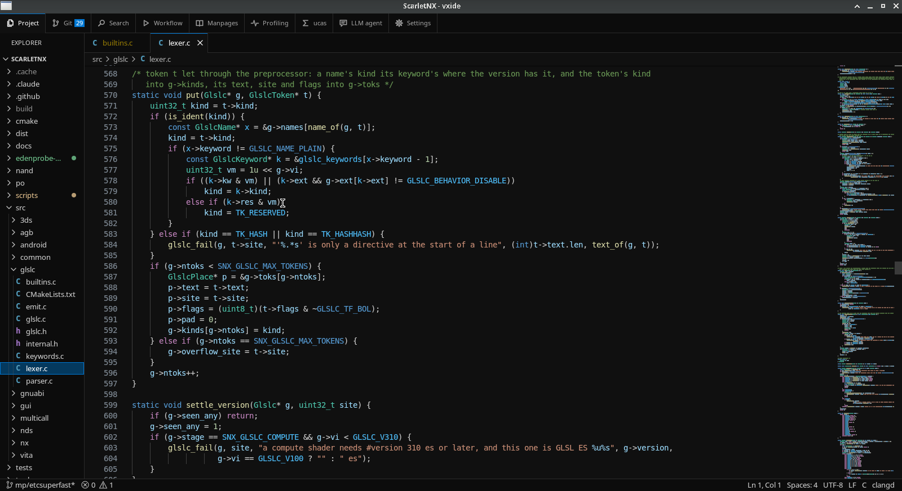
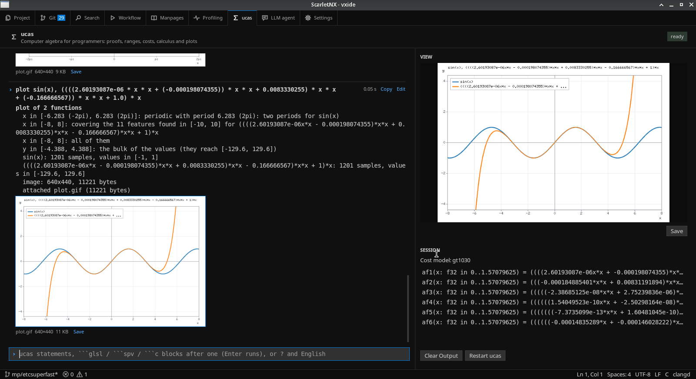
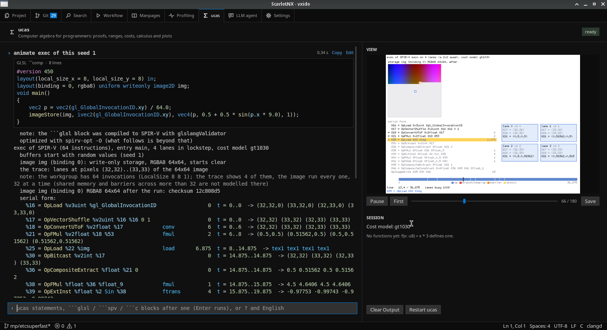

# vxide





A project-based code editor in C11, built with CMake, whose whole UI is
drawn with Vulkan. Its look and its keyboard shortcuts follow VSCodium
(Dark Modern / Light Modern themes, plus a near-black, higher-contrast
Dark Modern Darker; Dark+ / Light+ syntax colours). It
talks to clangd and rust-analyzer over LSP and to git through libgit2.

```
cmake -B build && cmake --build build -j       # build/vxide
ctest --test-dir build --output-on-failure      # unit tests + headless UI scripts
./build/vxide [--scale N] [--light] [DIR]
```

`-DVXIDE_SANITIZE=ON` builds with AddressSanitizer and UBSan.

There is no project file: the folder you open is the project. The
explorer hides `.git`, `.svn`, `.hg`, `.jj`, `CVS`, `.DS_Store` and
`Thumbs.db` (VSCodium's default `files.exclude`). Quick Open and Search
also skip `node_modules`, `bower_components` and git-ignored paths.

The UI keeps VSCodium's look, keys and words, and fixes what gets in the
way: unsaved changes are never dropped without asking, the last editors of
a folder come back on start, icon buttons have tooltips, status bar items
are clickable, and the narrow side bar lays itself out to fit. The
reasoning, the rules every component follows, and the list of annoyances
removed are in [docs/ui-design.md](docs/ui-design.md).

## Requirements

FreeBSD 15 (or Linux) with: a Vulkan 1.1 driver, `vulkan-loader`/headers,
`sdl3` (window and input only), `freetype2` (glyph rasters), `libgit2`,
`glslangValidator` (shaders are compiled at build time), `capstone`
(disassembly), and clangd / rust-analyzer in `PATH` for language features. Fonts: Noto Sans for the UI and
DejaVu Sans Mono for code, with DejaVu Sans as the fallback.

The first configure fetches [ucas](https://github.com/scarletnx/ucas) with
[CPM](https://github.com/cpm-cmake/CPM.cmake) (git and network needed once;
set `CPM_SOURCE_CACHE` to share the download between build folders), and
`awk`, `ld -r` and `objcopy` build it into vxide. `-DVXIDE_UCAS=OFF` leaves it
out (and the ucas tab says so).

## What it does

- **Workbench**: a row of top-level tabs. Project, Git and Search show
  their side bar next to the editors (clicking the active one hides it);
  Manpages, ucas, LLM agent and Settings are workspaces of their own that fill the main
  area. Up to three editor groups with tabs that wrap into rows and
  breadcrumbs, a panel
  (Problems, Output) and a status bar. The side bar and panel can be
  resized by dragging their edges. Everything is square: solid rects, 1 px
  borders, glyphs, and icons drawn from distance fields at start-up.
- **Editor**: multiple cursors, auto-closing brackets and quotes, smart
  Enter/indent, toggle comment, move/copy/delete lines, find/replace,
  bracket matching, indent guides, current-line box, selection-occurrence
  highlight, minimap, a scrollbar with an overview ruler (git changes,
  errors, cursor), and preview tabs.
- **Highlighting**: hand-written lexers for C23, C++26 (`.h` files with
  clear C++ markers too), Rust, Java, Kotlin, TOML, x86 assembly (AT&T/GAS and
  Intel/NASM, detected from the file head), Lisp (CL, Scheme, Elisp,
  Clojure), shell (sh/bash/zsh, heredocs), Markdown (with fenced code
  highlighted in its own language), troff/man/mdoc and Perl (POD, `s{}{}`,
  regexes, heredocs), CMake, Make (BSD and GNU; recipe lines highlighted as
  shell), JSON / JSON with Comments, ignore files (.gitignore and friends),
  diff/patch, git commit messages, git-rebase-todo, Python, YAML,
  CODEOWNERS, GLSL (`.glsl .comp .frag .vert` ..., the C lexer with GLSL's
  words), SPIR-V assembly (`.spvasm`), Sail (`.sail`: nested comments,
  `'n` type variables, `$include`/`$[attributes]`), Verilog and SystemVerilog
  (sized numbers, `` `define``, `$display`, module instantiations), Tcl
  (`.tcl .sdc .xdc`, tclsh/wish shebangs), Pascal and Object Pascal (`.pas`/`.pp`
  told apart by the file head), R, Ruby (heredocs, `%w[]`, `#{}` interpolation)
  ALGOL 68 (upper and quote stropping, `CO`/`#`/`¢` comments), Haskell (nested
  `{- -}`, `{-# pragmas #-}`, declarations), Windows batch (`.bat .cmd`: `%var%`,
  `%%i`, `!delayed!`, labels) and PowerShell (cmdlets, `[types]`, `$(...)` in
  strings, here-strings, `<# .SYNOPSIS #>`). Languages are also
  detected from shebangs and file heads. They were checked against VSCodium's own `c.tmLanguage.json`
  scopes and the Dark+/Light+ rules. When clangd is running, its semantic
  tokens are overlaid the way the clangd extension does it (readonly
  variables as constants, macros, parameters, ...).
- **LSP**: clangd for C and C++, rust-analyzer for Rust (started with the
  first `.rs` file). Diagnostics (squiggles, Problems, explorer and tab
  colours, F8), completion, hover, go to definition (F12 / Ctrl+click,
  with back/forward), semantic tokens. Positions use UTF-8 (UTF-16 is the
  fallback). rust-analyzer never builds the target: check on save, build
  scripts, proc-macro expansion and cache priming are off, so it only
  reads sources and `cargo metadata` (a build would churn a slow disk).
  `VXIDE_CLANGD` / `VXIDE_RUST_ANALYZER` pick other server binaries.
- **Manpages**: a workspace with a search bar (apropos, as you type) and
  its own tabs: "Index" (every page, or the matches, as links; it cannot
  be closed) and one tab per open page. Pages are rendered by mandoc
  (no pager) with bold / italic kept, and every `name(sec)` is a link
  (click or Enter, like info). Ctrl+F finds in the page shown (Ctrl+L goes
  to the apropos search). "Open Manpage" in the editor's context
  menu looks up the word under the mouse (`socket(` -> socket(2); C and
  C++ files try sections 2, 3, 9, 4 first).
- **Settings**: a workspace with a search bar and one fixed tab per
  category (Appearance, Editor, Git, Languages); a search goes to the
  setting's tab and marks it (Enter / Down for the next match). Saved in
  `$XDG_CONFIG_HOME/vxide/settings.conf`. Includes an editor background
  image (PNG / JPEG, scaled to cover the editor area, drawn over the
  text at an adjustable opacity, as VSCodium's background extensions do)
  and vim keybindings (off by default).
- **Qt**: QML language features from qmlls (with `-b` pointing at a CMake
  build folder when there is one), "Open in Qt Widgets Designer" for .ui
  files and "Open in Qt Linguist" for .ts files (explorer context menu or
  the palette), "Qt: Preview QML File" (runs `qml`, output in Output).
- **Godot**: GDScript language features from the Godot editor's language
  server over TCP (127.0.0.1:6005 for Godot 4, 6008 for Godot 3; it
  reconnects while GDScript files are open), "Godot Tools: Open Workspace
  with Godot Editor", Run Project (F5), Run Current Scene (F6; a script
  runs the scene next to it), Stop (Shift+F5), output in the Output panel,
  and an opt-in headless language server for when the editor is closed.
  `project.godot` is looked for in the folder and one level below it.
- **Binary files** (read-only): a hex editor like HxD (offset, hex and
  text columns with a shared selection, Tab switches column, a data
  inspector for the bytes at the cursor in little or big endian, named
  coloured tags from the context menu, Ctrl+G to an offset, Ctrl+C copies
  hex, Ctrl+F finds bytes such as `7f 45 4c 46`, or text). Executables (ELF, PE, Mach-O) get a subtab per section that has
  bytes in the file, plus "File": code sections are disassembled with
  capstone on a background thread (labels from symbols, branch targets
  annotated; Enter or double-click follows a branch), data sections open
  in the hex editor. Ctrl+F in a disassembly searches the decoded
  instructions and labels (regex too) in steps, so big sections stay
  responsive.
- **Profiles** (read-only tabs): valgrind massif (`massif.out.*`),
  jemalloc heap profiles (`*.heap`, `heap_v2` and the older
  `heap profile:` text, unbiased for sampling like jeprof), gprof
  (`gmon.out`, FreeBSD's `prog.gmon`; BSD and GNU formats, the executable
  is found next to it or set with "Profile: Set Executable for gprof...")
  and gcov (`*.gcov`, or `*.gcda` run through gcov). Subtabs: Memory Graph
  (massif: heap / extra heap / stacks over time, the peak, click a
  detailed snapshot to look at it), Top (self / total / calls, the
  selected function's callers and callees underneath), the bottom-up
  call tree (allocation sites, or where the time went, then their
  callers), a Flame Graph (click to zoom, Backspace out, Ctrl+F
  highlights), Hot Lines (with the line's text) and, for gcov, Coverage
  per file. gprof's flat histogram and call arcs are propagated the way
  gprof does it, so its flame graph and call-site costs are real.
  Addresses are symbolised with addr2line. A profile also colours source
  files: each line's cost as a heat background (yellow to red), its share
  or count in a gutter column with the five hottest lines numbered, call
  sites marked with the cost of what they call, never-run lines in red,
  marks in the overview ruler. "Profile: Go to Next / Previous Hot Line"
  walks them; "Profile: Annotate Source with Profile..." picks the
  profile; "Profile: Open Raw Report" shows gprof's or gcov's own text.
- **Workflow** (CMake, run, debug): a pane right of the editors (the
  Workflow tab toggles it), so the Explorer stays on the left; a stop
  opens its source line and raises the window. CMake: configure
  presets (CMakePresets.json with inherits / include / macros) or
  ./build, Configure and Build, the cache options (booleans toggle,
  values edit, advanced on demand). Run: an executable target from the
  CMake File API or any program, with arguments, in the project's folder,
  building first. Debug over DAP with lldb-dap (or gdb -i dap; VXIDE_DAP
  picks one): breakpoints in the gutter (F9, conditions, kept in the
  session and moved with the text), the execution line, step over / into
  / out (F10 / F11 / Shift+F11), continue / pause / stop / restart (F5,
  F6, Shift+F5, Ctrl+Shift+F5), the call stack of every thread (switch
  threads, select frames), variables by scope including registers
  (changed values marked), watch expressions, hardware watchpoints (break
  on write / read / both; the slots in use; software ones with gdb), and
  the debugger's value of the expression under the pointer in the hover
  next to the language server's. On FreeBSD's lldb, expressions that
  need the JIT (arithmetic, function calls) cannot be evaluated; plain
  variables, members and elements can.
- **Profiling** (FreeBSD): a top-level tab for hardware counters through
  hwpmc and pmcstat(8). It checks pmcstat first and, when the counters
  cannot be used, shows how to enable them (kldload hwpmc, loader.conf,
  security.bsd.unprivileged_proc_debug). Events from `pmcstat -L` are
  listed with a filter and toggles; a program runs with its arguments in
  the project's folder. Count mode shows the totals (and instructions per
  cycle); Sample mode records callchains and opens them as a profile
  (flame graph, callers, hot lines with source heat). `VXIDE_PMCSTAT`
  picks another pmcstat.
- **ucas** (computer algebra): a top-level tab with its own workspace, a
  REPL on [ucas](https://github.com/scarletnx/ucas), which is built into the
  vxide binary (`vxide --ucas ...`, or vxide run under the name `ucas`, is
  ucas's whole command line). Each input gets ucas's answer with how far it
  is established (symbolic, exhaustive, proved by SAT, or numeric: not a
  proof), its checks, notes and conditions; an ambiguity's readings are
  buttons that run it again. Plots, surfaces, contour and vector fields,
  integrals and solids of revolution, shader runs on images come back as
  pictures: inline, and the chosen one large in the View, animations
  playing (pause, seek, Save writes the GIF into the project). The Session
  side lists the functions defined (click: insert the name) and the active
  cost model. Enter runs (an open bracket goes on, indented, as ucas reads
  it), Shift+Enter starts another statement, Up/Down walk the history (kept
  with the project), Esc cancels a running evaluation and keeps the
  definitions, Ctrl+L clears. The transcript's text (inputs, code blocks,
  answers, errors) can be selected: drag (past the edge scrolls), double
  click a word, triple click a line, Shift+click extends; Ctrl+C copies
  it, and Ctrl+A with an empty input box selects the whole transcript. A line that reads as English goes through
  ucas's translator first, as in its own REPL; `?` asks for that.
  Code goes in fenced blocks after the statement it is for, as in ucas's own
  files: `simplify` + a ```` ```glsl ```` (or ```` ```comp ````, ```` ```frag ```` ...),
  ```` ```spv ```` or ```` ```c ```` block (shader simplification proved by SAT,
  or the C frontend), `animate exec of this` + a shader, `c optimize` + C; a
  block alone means `simplify`. The code is coloured by the editor's own
  lexers as it is typed (Enter in an open block adds a line; Enter after the
  closing ```` ``` ```` runs it) and in the transcript, as are the SPIR-V
  instructions, diffs and C in ucas's answers; the files it returns
  (`simplified.glsl`, `simplified.spvasm` ...) can be shown inline, opened
  in an editor tab or saved. In an editor, "ucas: Run Selection or Line in
  the ucas Tab" sends code there; from a GLSL, SPIR-V or C file it is sent as
  `simplify` and a block of that language.
  ucas runs as a child of vxide speaking its JSON frontend, so a crash or a
  long search never stalls the editor; every request runs under
  `timeout_s`, and Cancel stops only the forked evaluation (a small patch,
  `cmake/ucas-library.patch`, adds that and the library entry point).
  `cmake/ucas-adamfit.patch` adds `adamfit F in a..b`: thousands of
  expression shapes fitted by Adam, ranked by 0.8 x cost + 0.5 x error
  (both weights options), the closest ones' error proved (certified,
  enumerated, or by SAT) or stated for its sample; F can be a function of
  a ```c or ```glsl block (`adamfit NAME x in 0..1`), sampled natively, of
  up to 4 parameters, and integer results get fixed-point forms
  `(C x + B) >> s`; while it runs, the cell shows the candidates as ucas finds
  them and its progress (`auto` reports only the closest at the end). The
  patches are applied once, in order, by `cmake/ucas_patch.cmake`.
- **LLM agent**: a top-level tab where a local model works on the open
  project. It fills the window: on the left New Chat, the project's chats
  (newest first, kept as JSON in `$XDG_STATE_HOME/vxide/llm/<project>/`)
  and the harness; on the right, over the whole width that is left, the
  transcript and the question box (Enter sends, Shift+Enter a new line, Esc
  stops, Up recalls the last question). Answers are Markdown, drawn by the
  preview's renderer (code highlighted by its fence, tables, links; a
  `path:line` link opens the file there); the model's reasoning is folded,
  and each tool call is a row (running, done, failed, its time) that opens
  to its arguments and answer.
  The default harness is the tools of mcp-fbsd (a small MCP server in C)
  built in (`src/llmtools.c`): `read write edit ls stat mv mkdir
  search exec`, with its names, arguments and terse answers, every path
  confined to the project (links out of it too); exec runs `/bin/sh` in the
  project with `TERM=dumb NO_COLOR=1 PAGER=cat`, cleaned output, a timeout,
  and is killed by Stop. Read-only leaves only `read ls stat search`.
  The model is an OpenAI-compatible server, `POST /v1/chat/completions`
  streamed, by default llama.cpp's `llama-server` at
  `http://127.0.0.1:8080` (tool calls need `--jinja`); the server and the
  model are set in the tab. Auto uses the server when it answers and
  otherwise a mock model, which is not a language model: it reads the
  question for a command in backticks, a word to search for, or a file or
  folder of the project, calls that tool through the same harness and
  writes up the answer in Markdown, so the tab works end to end without a
  model. Server and Mock force one. The system prompt is three lines and
  the user's to change: "System Prompt..." opens
  `$XDG_CONFIG_HOME/vxide/llm-system.md` (written from the default the
  first time), read at every turn, `{root}` being the project folder.
  "LLM Agent: Ask About the Selection" puts an editor's selection in the
  box as a fenced block with its file.
- **Markdown preview**: Markdown tabs have Edit and Preview subtabs
  (Ctrl+Shift+V): headings, emphasis, code (highlighted by the fence's
  language), lists and task lists, quotes, tables, links (anchors, files,
  URLs); double-click in the preview edits that spot.
- **Search**: the editor find widget and the Search view share one
  matcher: literal, case, whole word, and regex (Alt+C / Alt+W / Alt+R). The
  Search view has replace with a struck-out/inserted preview, Replace All
  (Ctrl+Alt+Enter), per-file and per-match replace and dismiss,
  files to include/exclude globs (Ctrl+Shift+J), and F4/Shift+F4 to step
  through results. Files that are open are edited in their buffers (one
  undo step); other files are rewritten atomically.
- **Regex engine** (`src/regex.c`): built in, modelled after RE2 and
  linear time. The pattern compiles to byte-level instructions, with
  UTF-8 classes as byte-range sequences. A lazy DFA finds the earliest
  match end, and a Pike VM then finds the leftmost-first match and its
  groups on that line. RE2 syntax: classes, `[[:alpha:]]`, `\d \w \s`
  (ASCII), `\b`, lazy quantifiers, `{n,m}` up to 1000, named groups,
  `(?i)`, `\Q..\E`, `\x{..}`. Lookaround and backreferences are
  rejected with RE2's messages. `^`/`$` match per line, and matches cross
  line ends only when the pattern contains `\n` (as in VSCodium).
  Replacements take `$0`/`$&` (whole match), `$1`, `${1}`, `$name`, `$$`, `\n`, `\t` and
  the case operators `\u \l \U \L \E`. On this host the DFA scans
  about 540 MB/s; `(a+)+b` over 100k characters takes 0.3 ms.
- **Search** skips git-ignored files (search.useIgnoreFiles), also when
  the project is a subfolder of the repository; files in results, Quick
  Open, tabs and the explorer carry their git colour (yellow modified,
  green untracked/added, red deleted, grey ignored).
- **Slow disks** (written for a 5400 RPM drive): nothing on the UI thread
  waits on the disk. Git status runs on a worker thread (with stat data
  written back to the index, like `git status`) when something happens -
  a save, a git operation, a change under .git, window focus - plus a 60 s
  fallback, instead of every 3 s. The explorer reacts to kqueue / inotify
  events on its open folders instead of rescanning every 5 s, and reads
  entry types from readdir (no stat per file). Quick Open's file list and
  Search run on background threads; Search reads files in inode order with
  sequential read-ahead and reports progress. Opened files get read-ahead
  (posix_madvise WILLNEED); clangd's background index runs at low priority.
  Idle file-system lookups on a 3800-file repository went from about 36,400
  to 7,900 per 12 s (the one initial status), and none after that.
- **Git blame** on the cursor line, on by default (VSCodium's
  `git.blame.editorDecoration`): `summary, author (3 days ago)`, or
  "Not Committed Yet" for edited lines. It runs on libgit2 with its own
  engine (`src/lgblame.c`): libgit2's git_blame_file diffs whole trees at
  every step (12 s on a 22k-line file with 1915 commits); this one looks
  up only the tree entries along the file's path (memoised by tree id),
  diffs blobs on a thread pool, and stops once every line has an owner -
  0.28 s for that file (git: 0.25 s), matching `git blame` on 64,945 lines
  but two ambiguous diff placements. The live buffer is mapped onto the
  HEAD blob with one diff per edit. Toggle it
  with "Git: Toggle Git Blame Editor Decoration". Hovering the blame text
  shows the commit: author, relative and absolute date, the full message,
  hash and change stats.
- **Source Control graph** (VSCodium's scm.graph, "auto": the current
  branch, its upstream and its base): a GRAPH section with
  square lanes and commit markers (hollow for HEAD, ringed for merges),
  branch/tag badges, a hover card per commit, click to list a commit's
  files, click a file to open its diff, double click to open the whole
  commit. Right click: checkout (detached), create branch/tag, cherry pick,
  copy id/message.
- **Git actions** from the view's "..." menu and the palette, run
  asynchronously on libgit2 (the git CLI only as a fallback when an https
  remote needs a credential helper), with output in Output > Git: pull/push/fetch/sync
  (prune, rebase, force with lease), publish, checkout, create/rename/delete
  branch, merge, rebase (continue/abort), abort merge, stash (include
  untracked, apply/pop/drop latest or picked), tags, commit all/amend, undo
  last commit, unstage/discard all. Rebase/merge in progress shows in the
  view. "Git: Open Changes" shows a file's diff read-only.
- **Diff editor** (VSCodium style, side by side): unchanged lines face each
  other, changed lines are paired with word-level highlights, filler rows
  pad the shorter side. Working-tree diffs keep the real file editable on
  the right. Each change has Stage and Revert buttons (Unstage in staged
  diffs); Git: Stage / Unstage / Revert Selected Ranges (Ctrl+K Ctrl+Alt+S,
  Ctrl+K Ctrl+N, Ctrl+K Ctrl+R) apply every change touching the selection,
  in normal editors as well. Clicking a quick-diff mark in the gutter offers
  Stage Change / Revert Change / Open Changes; Alt+F5 / Shift+Alt+F5 go to
  the next / previous difference. Ctrl+F finds in the new side. Source
  Control opens diffs on click.
- **Merge conflicts**: the markers stay as plain, editable text (no Accept
  buttons); current / base / incoming regions are shaded with VSCodium's
  merge colours and labelled. Conflicted files are listed under "Merge
  Changes"; "+" or Git: Mark as Resolved stages the file, and refuses while
  markers remain. Merge Conflict: Next / Previous Conflict navigate.
- **Overtype**: Insert toggles insert/overtype (block cursor, OVR in the
  status bar); pasting overtypes too.
- **Context menus** (right click): editor (go to definition, declaration,
  type definition, references, find all references, change all occurrences,
  cut/copy/paste, toggle comment, command palette), explorer, tabs, Source
  Control files and graph rows.
- **Mouse cursors**: I-beam over text and inputs, a hand on Ctrl+hover
  (go to definition), resize arrows on the sashes.
- **Git**: branch and ahead/behind in the status bar, explorer
  decorations (M/U/A/D colours, folder dots, ignored files greyed out),
  quick-diff gutter against the index, and a Source Control view with
  stage, unstage, discard and commit (Ctrl+Enter, with a "stage all and
  commit?" prompt when nothing is staged).
- **Files**: documents are piece tables over the file `mmap`ed read-only
  (`MAP_PRIVATE`). Lines that sit in one piece are drawn straight from the
  mapping. A save writes a temp file, `fsync`s it, `rename`s it over the
  original, then remaps it. CRLF files keep CRLF, and tabs vs spaces are
  detected per file.

## Keys (VSCodium Linux defaults)

| Keys | Action |
|---|---|
| Ctrl+P | Go to file (`:N` goes to a line, `>` runs commands) |
| Ctrl+Shift+P, F1 | Command palette |
| Ctrl+G | Go to line |
| Ctrl+S, Ctrl+K S | Save, save all |
| Ctrl+N | New untitled file (saving asks for a path) |
| Ctrl+W, Ctrl+K W | Close editor, close all |
| Ctrl+Tab, Ctrl+PgUp/PgDn | Switch editors |
| Ctrl+\\, Ctrl+1/2/3 | Split editor, focus group |
| Ctrl+B, Ctrl+J | Toggle side bar, toggle panel |
| Ctrl+Shift+E / F / G | Explorer / Search / Source Control |
| Ctrl+Shift+M, Ctrl+Shift+U | Problems, Output |
| Ctrl+F, Ctrl+H, F3, Shift+F3 | Find, replace, next, previous (Alt+C case, Alt+W word, Alt+R regex) |
| Enter / Ctrl+Alt+Enter in replace | Replace one / replace all |
| Ctrl+Shift+H, Ctrl+Shift+J, F4/Shift+F4 | Replace in files, include/exclude globs, next/previous result |
| Ctrl+D, Ctrl+K Ctrl+D, Ctrl+Shift+L, Ctrl+F2 | Add next occurrence, move last selection to next, select / change all occurrences |
| Shift+Alt+Up/Down, Ctrl+Shift+Up/Down, Alt+click | Add cursor above/below, add cursor |
| Shift+Alt+I, Ctrl+U | Cursors at the ends of the selected lines, cursor undo |
| Shift+Alt+drag, middle drag, Ctrl+Shift+Alt+arrows/PgUp/PgDn | Column (box) selection |
| Shift+F12, Shift+Alt+F12 | Go to references, find all references |
| Ctrl+Alt+C, Ctrl+Shift+Alt+C | Copy path, copy relative path |
| Alt+Up/Down, Ctrl+Shift+Alt+Up/Down | Move line, copy line |
| Ctrl+Shift+K, Ctrl+Enter, Ctrl+Shift+Enter | Delete line, insert line below/above |
| Ctrl+/, Ctrl+], Ctrl+[ | Toggle comment, indent, outdent |
| Ctrl+L, Ctrl+A | Select line, select all |
| Ctrl+Space, Ctrl+K Ctrl+I | Suggest, hover |
| F12, Ctrl+click, Ctrl+Alt+-, Ctrl+Shift+- | Definition, back, forward |
| F8, Shift+F8 | Next/previous problem |
| F5, Ctrl+F5, Shift+F5, Ctrl+Shift+F5 | Debug / continue, run without debugging, stop, restart |
| F9, F10, F11, Shift+F11, F6 | Toggle breakpoint, step over, step into, step out, pause |
| Ctrl+K Ctrl+T | Toggle dark/light theme (also in Settings) |
| Ctrl+, | Settings (theme, blame, minimap, language servers) |
| Ctrl+Shift+P | Command palette (delete the `>` to search files); includes Transform to Upper/Lower/Title/Snake/Kebab Case |
| Insert | Toggle overtype |
| Ctrl+K Ctrl+Alt+S, Ctrl+K Ctrl+N, Ctrl+K Ctrl+R | Stage / unstage / revert selected ranges |
| Alt+F5, Shift+Alt+F5 | Next / previous difference in a diff |
| Explorer: arrows, Enter, Space, F2, Delete | Navigate, open, preview, rename, delete |

## Layout of the code

Data-oriented: state lives in tables named by `u32` indices, each table
one coalesced struct-of-arrays block (`soa_grow`), strings in pools, and
nothing kept that already exists (unmodified files are their mapping, the
glyph atlas and the quads live in GPU-mapped memory). Per-frame work is a
linear pass that writes quads straight into the frame's GPU buffer. The
rules and measurements (a typical session holds ~1.7 MB of vxide's own
heap) are in [docs/memory.md](docs/memory.md); `-DVXIDE_HEAPTRACE=ON` and
the script command `heap` measure it.

| File | Role |
|---|---|
| `src/gpu.c` | Vulkan: one render pass, one pipeline, one instanced draw per frame; swapchain or offscreen target |
| `shaders/ui.*` | A quad is a solid rect, an atlas coverage rect (`texelFetch`), a squiggle, or a picture: an RGBA atlas made on first use, placed per frame by a small uniform table and sampled by pixel position (plots, animations) |
| `src/font.c`, `src/icons.c` | FreeType glyph cache in an R8 atlas (shelf packer, open hashing); icons from SDF primitives |
| `src/draw.c` | Quad list with CPU clipping (atlas origins move with the cut) |
| `src/text.c` | mmap piece table, line-start index, undo log (SoA) |
| `src/syntax.c` | Line lexers with a per-line state, cached per document |
| `src/regex.c` | RE2-style regex: byte program, lazy DFA, Pike VM, replacement expansion |
| `src/blame.c` | Inline blame worker thread (git CLI, libgit2 fallback) |
| `src/gitgraph.c`, `src/gitops.c` | Commit graph lanes, commit details; async git runner and queries |
| `src/gitui.c` | Graph section, git actions, hover cards |
| `src/lgblame.c` | Blame on libgit2 primitives |
| `src/githunk.c`, `src/diffview.c` | Hunks, word diffs, range staging, conflicts; the diff editor |
| `src/fswatch.c`, `src/bgwork.c` | kqueue/inotify watches; background file scan and search |
| `src/menu.c`, `src/actions.c` | Context menus, picker, references, multi-cursor and path actions |
| `src/lsp.c`, `src/json.c` | LSP client over pipes (non-blocking), jsmn-style token table |
| `src/git.c` | libgit2: status table, index ops, commit, quick diff |
| `src/fstree.c`, `src/search.c` | Explorer tree, file walk, fuzzy match, text search |
| `src/ui.c` | Layout, input routing, keybindings, commands, tabs, status bar, quick input |
| `src/editor.c` | Editor drawing and editing, find, completion, hover |
| `src/binfile.c`, `src/binview.c` | ELF/PE/Mach-O sections and symbols, capstone disassembly, data inspector; the hex editor and section subtabs |
| `src/dap.c`, `src/cmake.c`, `src/workflow.c` | DAP client and session model; CMake presets, cache and File API targets; the Workflow side bar and the editor's debug decorations |
| `src/prof.c`, `src/profview.c` | Profile parsers (massif, jemalloc, gmon, gcov), addr2line, gprof propagation, call trees; the profile tabs and source heat colouring |
| `src/panes.c` | Explorer, Search, Source Control, Settings workspace, Problems, Output, wrapping input box |
| `src/man.c` | Manpages workspace: mandoc rendering, links, apropos Index |
| `src/projtools.c` | Qt and Godot: tools, project detection, run/stop with output |
| `src/imgload.c` | PNG / JPEG decoding for the background image |
| `cmake/ucas.cmake`, `cmake/CPM.cmake` | ucas fetched by CPM, its sources read from its Makefile, linked into one object whose only global is `ucas_main` |
| `src/ucasproto.c`, `src/ucasview.c`, `src/ucasimg.c` | ucas's JSON frontend (requests, responses, base64); the ucas tab (worker process, transcript, View, Session); its GIFs and PNGs decoded by ucas's stb_image |
| `src/llmtools.c`, `src/llmchat.c`, `src/llmview.c` | The LLM agent: the built-in harness (mcp-fbsd's tools, confined to the project); chats, their JSON, the streamed OpenAI-compatible client, the mock model, a turn's loop; the tab (chats, transcript, harness, the turn's thread) |

## Testing without a display

`vxide --headless WxH --script FILE DIR` renders into an offscreen Vulkan
image and runs a script of `open`, `key ctrl+shift+p`, `type text\n`,
`click X Y`, `dclick`, `rclick`, `drag X Y X2 Y2`, `move`, `wheel DY X Y`, `wait MS`, `waitlsp`, `expect text|line|file|problems ...`,
`print` and `shot out.png`. `tests/t_ui.sh` uses it. To run the real
windowed path without a display, set `SDL_VIDEO_DRIVER=offscreen` (NVIDIA
supplies `VK_EXT_headless_surface`).

Environment variables: `VXIDE_NO_LSP`, `VXIDE_CLANGD`, `VXIDE_RUST_ANALYZER`, `VXIDE_QMLLS`,
`VXIDE_GODOT`, `VXIDE_GODOT_PORT`, `VXIDE_BG` / `VXIDE_BG_OPACITY`, `VXIDE_SETTINGS` (settings file; headless runs read none unless it is set), `VXIDE_THEME=light`,
`VXIDE_GPU=<name substring>`, `VXIDE_VALIDATE` (Khronos validation layer),
`VXIDE_LOG` (copy the Output log to stderr), `VXIDE_NO_BLAME`,
`VXIDE_LLM_SERVER`, `VXIDE_LLM_BACKEND=auto|server|mock`, `VXIDE_LLM_API_KEY`
(sent as a bearer token), `VXIDE_LLM_SYSTEM` (the system prompt's file),
`VXIDE_BLAME_LIBGIT2` (force the libgit2 blame), `VXIDE_ADDR2LINE` / `VXIDE_GCOV` (the
symboliser / gcov used for profiles).

## Not done yet

No integrated terminal, folding, word wrap, rename or code actions. There
is no push/pull. Binary files cannot be edited yet. The
UI scale is a whole number (1x or 2x), and IME composition is untested.
